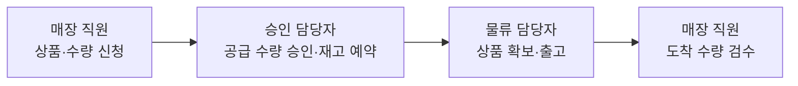
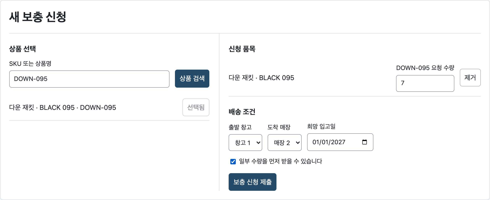
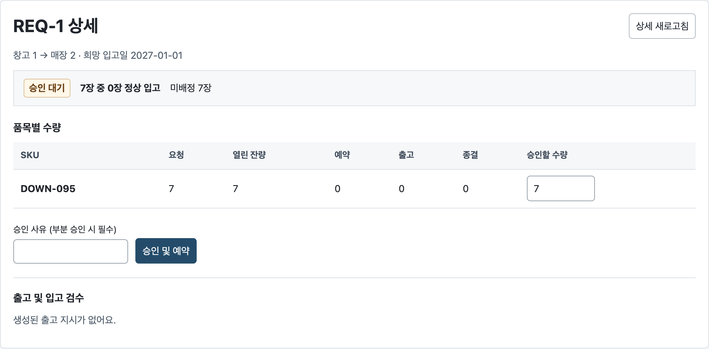
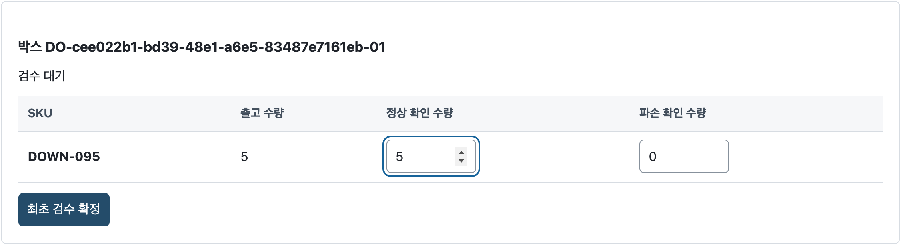
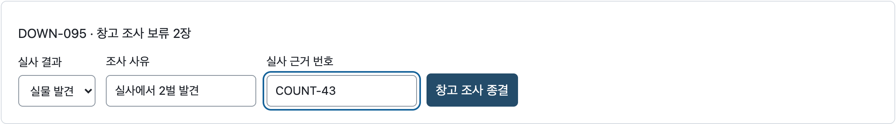
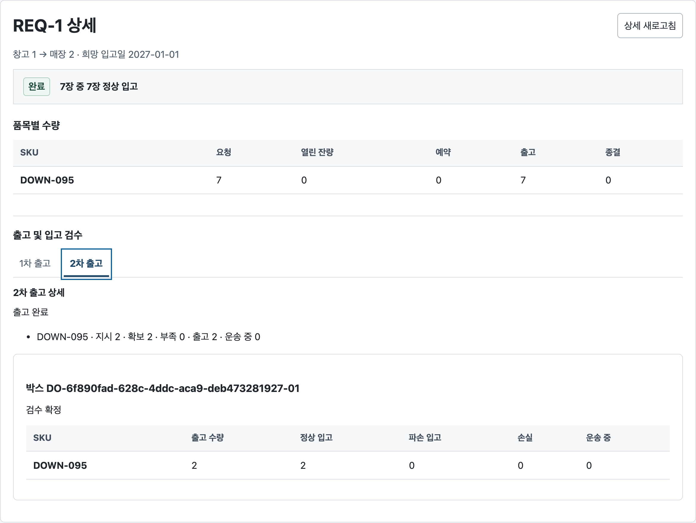
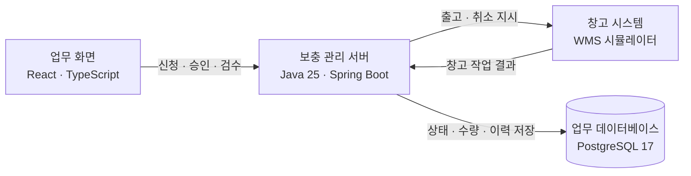

# 패션 매장 재고 보충 관리 시스템

매장의 상품 보충 신청부터 물류센터 출고와 매장 입고 검수까지 관리합니다.

요청 한 건에서 실제 입고 수량과 남은 조치를 확인할 수 있습니다.

---

# 보충 요청은 매장·승인·물류를 거쳐 처리된다



---

# 매장 직원이 필요한 상품과 수량을 신청한다



상품을 검색해 신청 품목에 넣고, 수량과 배송 조건을 입력합니다. 일부만 먼저 받아도 되는지 신청 때 남겨, 물류 담당자가 출고 중 부족을 발견했을 때 판단할 수 있습니다.

**제출 후 → 승인 대기**

---

# 승인 담당자가 공급할 수량을 정한다



승인 대기 목록에서 요청을 열고 품목별 수량을 확인해 **승인 및 예약**을 실행합니다. 물류는 예약된 수량으로 출고를 준비할 수 있습니다. 재고가 부족하면 승인 결과를 저장하지 않고 가용 수량을 알립니다.

**승인·예약 후 → 이행 중**

---

# 매장 직원이 1차 입고 수량 5벌을 확정한다

매장 직원이 도착한 박스를 열어 실물 5벌을 확인합니다.



**정상 확인 수량 5 입력 → 최초 검수 확정**

**정상 입고 5벌 · 보충 요청 이행 중**
물류센터에서 처음 확보하지 못한 2벌은 조사 대상으로 남습니다.

---

# 물류 담당자가 실사 결과를 기록하고 후속 출고를 준비한다



출고 상세에서 **실물 발견**을 선택하고 사유와 근거 번호를 남겨 조사를 종결합니다. 발견한 2벌은 재고로 돌아옵니다. 추가 승인·예약을 거쳐 2차 출고를 지시합니다.



**누계 7벌 입고 · 요청 완료**

---

# 상태를 보면 다음 조치를 정할 수 있다

| 관리 단위 | 화면에서 보는 상태 | 담당자가 확인하거나 할 일 |
|---|---|---|
| 보충 요청 | 승인 대기 · 이행 중 · 완료 | 승인 담당자는 대기 건을 열고, 매장은 입고 누계와 미배정 잔량을 확인합니다. |
| 출고 지시 | 접수 미확인 · 작업 중 · 출고 완료 | 물류는 현재 회차가 어느 단계인지 확인합니다. |
| 출고 취소 | 확인 중 · 확정 · 거절 | 물류는 창고의 취소 확정까지 예약을 유지합니다. |
| 박스 검수 | 검수 대기 · 검수 확정 | 매장은 박스별 정상·파손 수량을 확정합니다. |
| 수량 차이 | 조사 중 · 종결 | 담당자가 부족이나 파손의 처리 결과를 기록합니다. |

**요청 완료 기준**　미배정·예약·운송 수량이 0이고, 출고 지시·취소 확인·검수·조사가 모두 끝나야 합니다.

---

# 7벌을 한 번에 보내야 한다면 어떻게 마감하나

같은 피킹 부족 상황에서 매장이 부분 이행을 허용하지 않은 경우입니다.

1. 창고의 출고 취소 확정을 기다립니다. 확정되면 확보했던 5벌의 예약을 해제합니다.
2. 부족한 2벌의 실사 결과를 기록합니다. 요청의 열린 잔량은 7벌입니다.
3. 재공급이 불가능하면 미충족 사유를 기록합니다. 조사와 잔량 처리를 마치면 **입고 0벌 · 미충족 7벌**로 완료합니다.

**요청 수량 = 열린 잔량 + 예약 + 출고 + 미충족 종결**

PostgreSQL 제약으로 수량을 검사하고, 재고 변경과 업무 이력을 같은 트랜잭션에 저장합니다.

---

# 창고의 응답이 끊겨도 출고 지시를 이어간다



창고가 이미 지시를 저장했을 수 있으므로 예약을 유지합니다. Outbox에서 같은 외부 지시 번호로 재전송하고, Inbox에서 중복 작업 결과를 걸러냅니다.

---

# 자동 검증 결과

| 검증 시나리오 | 확인한 결과 |
|---|---|
| 정상 입고 | 6벌 출고 → 6벌 입고 → 요청 완료 |
| WMS 응답 타임아웃 | 같은 지시 2회 전송 · 출고와 차감 각 1회 |
| 두 차례 출고 | 첫 입고 5벌에서 이행 중 · 누계 7벌에서 완료 |
| 전량 미충족 | 입고 0벌 · 미충족 7벌 · 조사 종결 후 완료 |

```sh
python3 scripts/run-demo.py
```

Docker Compose · PostgreSQL 17.12
