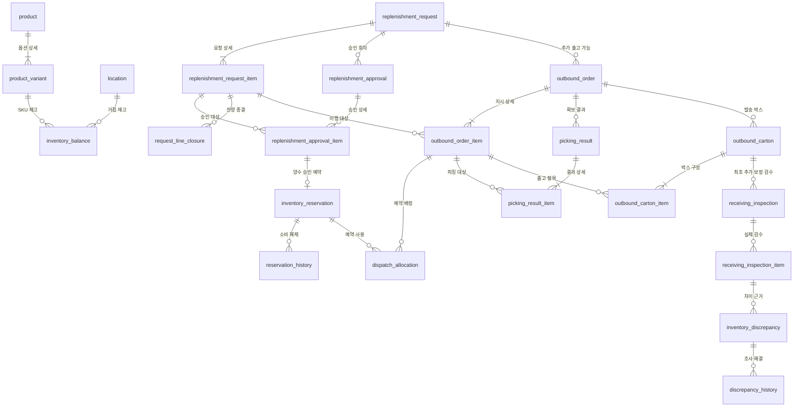

# 테이블 설계서 v0.1

상태·종결 조건은 [보충 이행 상태 명세](fulfillment-state-design.md)에서 상세화한다. 출고 상태에는 PICKING_EXCEPTION·READY_TO_SHIP을 포함하며, 검수 대기는 별도 저장 상태가 아니라 최초 검수 문서 유무로 계산한다. 해당 명세를 기준으로 후속 DDL을 작성한다.

관련 문서: [요구사항](requirements.md) · [스택](technology-stack.md) · [모듈](module-design.md) · [승인·예약](approval-reservation-design.md)

## 1. 범위와 문서 상태

매장 재고 보충의 요청·승인·예약·출고·입고·차이 처리를 위한 논리·컬럼 설계 초안이다. 창고 전체를 운영하는 WMS가 아니라 보충 이행 관리 시스템이다. 아래 구조는 프로젝트 가정이며 실제 기업 스키마가 아니다. SQL 마이그레이션 및 실행 검증은 아직 수행하지 않았다.

업무 메인·상세를 구분하며 각 메인에 현재 상태를 저장한다. 상태 전이 규칙은 도메인 코드로 구현하고, 변경 이력은 같은 트랜잭션에서 저장한다. 범용 워크플로 엔진·전이 정의 테이블은 초기 범위에 두지 않는다.

## 2. 공통 규약

- PK는 `id bigint generated by default as identity`. 연결 컬럼은 bigint FK를 사용한다. 내부 ID와 사용자에게 보여줄 문서 번호는 구분한다.
- `NN`은 NOT NULL, `UQ`는 UNIQUE, `?`는 NULL 허용이다. 별도 표시가 없는 업무 컬럼은 NN이다.
- 수량은 integer이며 요청·지시·변동량 등 양수 조건과 집계의 0 이상 조건을 구분한다. 이동 원장의 증감 컬럼만 음수를 허용한다.
- 상태·유형은 varchar와 CHECK로 관리한다. 허용값은 업무별 전이 명세에 맞춰 Flyway로 변경한다.
- 시각은 timestamptz, 업무 날짜는 date. 서버·DB 세션은 UTC, 화면은 한국 시간으로 표시한다.
- 변경 가능한 업무 메인에는 `version bigint`, `created_at`, `updated_at`을 둔다. 확정 문서·이력은 수정 대신 연결된 보정 기록을 남긴다.
- 사용자 FK는 삭제 제한하며 계정 비활성화로 처리한다. 업무 FK는 기본 ON DELETE RESTRICT다.
- 모듈 간에도 필요한 DB FK를 둔다. Java에서는 ID와 공개 API로 접근하며 타 모듈 Repository를 직접 사용하지 않는다.
- JSONB는 메시지 본문·응답 보관에 사용한다. 상품·수량·주요 관계를 JSONB에만 저장하지 않는다.
- 문서의 후보 인덱스는 구현 후 쿼리 계획과 실제 조회로 검증한다. 모든 컬럼에 인덱스를 추가하지 않는다.

## 3. 메인·상세와 상태 소유권

| 업무 | 메인 | 상세·이력 | 현재 상태 |
|---|---|---|---|
| 상품 | product | product_variant | 각각 active |
| 조직 | location | user_location | location.active |
| 보충 요청 | replenishment_request | replenishment_request_item, request_line_closure, request_status_history | 요청 메인 status |
| 승인 | replenishment_approval | replenishment_approval_item | 승인 메인 decision |
| 재고 | inventory_balance | inventory_movement | 정상·보류·예약 수량 |
| 예약 | inventory_reservation | reservation_history | 잔량으로 ACTIVE/CLOSED 계산 |
| 출고 지시 | outbound_order | outbound_order_item, dispatch_allocation, outbound_status_history | 출고 메인 status |
| 피킹 결과 | picking_result | picking_result_item | 확정 결과 문서 |
| 박스 | outbound_carton | outbound_carton_item | 박스 메인 status |
| 입고 검수 | receiving_inspection | receiving_inspection_item, receiving_status_history | 검수 메인 status |
| 차이 조사 | inventory_discrepancy | discrepancy_history | 조사 메인 status |
| 연동 | outbox_message, inbox_event | integration_attempt | 각 메시지 처리 상태 |
| 명령 중복 방지 | command_result | 없음 | 성공 결과만 저장 |

## 4. 업무 ERD

도식은 핵심 관계만 표시한다. 수량 차이는 피킹·검수에서 모두 발생할 수 있으므로 검수 외 발생 근거 FK도 가진다. 초안에서 출고 지시는 하나의 요청만 참조한다. 한 요청은 여러 승인과 여러 출고 지시를 가질 수 있다.

## 5. 상품·조직·계정

| 테이블 / 모듈 | 주요 컬럼 | 키·규칙 |
|---|---|---|
| product / catalog | product_code varchar(40), name varchar(160), season_code varchar(20), active boolean | product_code UQ; 스타일 단위 상품 기본 |
| product_variant / catalog | product_id FK, sku_code varchar(60), color_code varchar(30), size_code varchar(30), barcode varchar(80) ?, active boolean | sku_code UQ, barcode UQ, (product_id,color_code,size_code) UQ; SKU는 옵션 한 행의 코드 |
| location / organization | location_code varchar(40), name varchar(120), type varchar(20), active boolean | location_code UQ; type=WAREHOUSE/STORE |
| app_user / identity | login_id varchar(100), password_hash varchar(255), display_name varchar(100), active boolean | login_id UQ; 비밀번호 평문 저장 금지 |
| user_role / identity | user_id FK, role_code varchar(40) | (user_id,role_code) UQ |
| user_location / organization | user_id FK, location_id FK, active boolean | (user_id,location_id) UQ; 소속 거점 접근 범위 |

색상·사이즈는 초기에는 옵션의 코드 컬럼으로 둔다. 관리 화면이나 별도 속성이 필요할 때 코드 마스터를 추가한다. 로그인 세션은 초기 단일 인스턴스의 서버 세션을 사용하며 별도 분산 세션 테이블은 만들지 않는다.

## 6. 보충 요청 및 승인

### 6.1 보충 요청 메인: replenishment_request

| 컬럼 | 의미·제약 |
|---|---|
| id | PK |
| request_no varchar(40) | 사용자 표시 문서 번호, UQ |
| source_location_id | 출발 창고 FK |
| destination_location_id | 목적 매장 FK |
| requested_by | 요청자 app_user FK |
| status varchar(30) | DRAFT/SUBMITTED/FULFILLING/REJECTED/CANCELLED/COMPLETED |
| cancellation_intent_status varchar(20) | NONE/REQUESTED/CONFIRMED/REJECTED. 출고 지시 생성 이후 전체 취소를 조율하는 상태 |
| allow_partial boolean | 부분 이행 허용 여부 |
| desired_receipt_date date | 희망 입고일 |
| submitted_at timestamptz ? | 제출 시각 |
| version / created_at / updated_at | 동시 명령·이력 기준 |

출발·도착이 같지 않도록 CHECK를 둔다. 출발 거점이 창고이고 도착 거점이 매장인지, 활성 여부·사용자 소속은 서비스에서 검증한다. 제출 이후 항목과 정책은 변경하지 않는다.

### 6.2 요청 상세와 승인 문서

| 테이블 | 주요 컬럼 | 제약·역할 |
|---|---|---|
| replenishment_request_item | request_id FK, line_no integer, variant_id FK, requested_qty, open_qty, reserved_qty, shipped_qty, closed_qty | (request_id,line_no), (request_id,variant_id) 각각 UQ; requested_qty>0, 나머지>=0; requested_qty=open_qty+reserved_qty+shipped_qty+closed_qty |
| replenishment_approval | request_id FK, approval_no integer, decision varchar(20), decided_by FK, reason text ?, decided_at timestamptz | (request_id,approval_no) UQ; decision=APPROVED/REJECTED; 반려 또는 부분 승인은 사유 필수 |
| replenishment_approval_item | approval_id FK, request_item_id FK, approved_qty integer | (approval_id,request_item_id) UQ; approved_qty>=0; 승인 회차에 모든 요청 항목 포함 |
| request_line_closure | request_item_id FK, qty integer, reason_code varchar(40), reason text, actor_id FK, occurred_at | qty>0; 취소·미충족 종결의 근거, 확정 후 변경 금지 |

반려도 승인 메인의 decision으로 기록한다. 반려에는 승인 상세가 없으며, 승인 회차는 최소 하나의 양수 승인 상세가 필요하다. 이 규칙과 부분 불허 시 전량 승인 규칙은 요청 잠금 아래 서비스에서 검증한다.

요청 상세의 수량은 현재 이행 집계다. 개별 예약과 실제 출고 사실은 각 소유 모듈에서 관리하며 조율 유스케이스가 같은 트랜잭션에서 집계를 반영한다. 누적 승인량을 reserved_qty로 사용하지 않는다.

## 7. 재고·예약·원장

| 테이블 | 주요 컬럼 | 제약·역할 |
|---|---|---|
| inventory_balance | location_id FK, variant_id FK, normal_qty, held_qty, reserved_qty, version, updated_at | (location_id,variant_id) UQ; 모두>=0; reserved_qty<=normal_qty |
| inventory_reservation | approval_item_id FK UQ, balance_id FK, initial_qty, consumed_qty, released_qty, created_at | initial_qty>0; consumed/released>=0; consumed_qty+released_qty<=initial_qty |
| reservation_history | reservation_id FK, action varchar(20), qty, operation_id uuid, occurred_at, actor_id FK ? | action=CREATE/CONSUME/RELEASE; qty>0; (reservation_id,operation_id) UQ |
| inventory_movement | balance_id FK, movement_type varchar(40), normal_delta, held_delta, reserved_delta, operation_id uuid, entry_no integer, source_type, source_id bigint, reversal_of_id FK ?, actor_id FK ?, reason text, occurred_at | (operation_id,entry_no) UQ; 증감 중 하나 이상이 0이 아님; 확정 후 추가 기록만 허용 |

가용 수량은 normal_qty-reserved_qty, 예약 유효 잔량은 initial_qty-consumed_qty-released_qty로 계산한다. 별도 수정 가능한 상태·가용 수량을 중복 저장하지 않는다.

원장의 source_type/source_id는 여러 업무 문서를 연결하는 추적용 논리 참조다. 일반 FK로 모든 대상을 보장할 수 없으므로 소유 모듈의 명령에서 실제 근거를 검증하고 삭제하지 않는다. 핵심 업무 관계인 승인→예약 및 출고→배정은 명시적 FK로 보호한다. 피킹 위치는 WMS 외부 ID로 기록하며 로컬 잔액을 위치별 재고로 확대하지 않는다.

예약은 정상 실물에 포함된다. 예약만 발생한 원장 항목은 normal_delta=0, reserved_delta>0이다. 부족 2장을 보류 전환하며 예약 해제하면 normal_delta=-2, held_delta=+2, reserved_delta=-2다. 승인된 손실 처리는 held_delta를 감소시키고 근거를 남긴다.

## 8. 출고 지시·피킹·박스

| 구분 | 테이블 | 주요 컬럼·규칙 |
|---|---|---|
| 메인 | outbound_order | order_no UQ, request_id FK, external_order_id UQ, status, cancellation_status, version, created_at, updated_at |
| 상세 | outbound_order_item | order_id FK, request_item_id FK, instructed_qty>0; (order_id,request_item_id) UQ |
| 연결 상세 | dispatch_allocation | order_item_id FK, reservation_id FK, allocated_qty>0, shipped_qty>=0, released_qty>=0; (order_item_id,reservation_id) UQ; shipped_qty+released_qty<=allocated_qty |
| 피킹 메인 | picking_result | order_id FK, inbox_event_id FK UQ, external_work_id, external_revision bigint, confirmed_at; (order_id,external_work_id,external_revision) UQ |
| 피킹 상세 | picking_result_item | result_id FK, order_item_id FK, external_location_code ?, picked_qty>=0, shortage_qty>=0, reason_code ?; (result_id,order_item_id) UQ |
| 박스 메인 | outbound_carton | order_id FK, carton_no UQ, status, shipped_at ?, version, created_at, updated_at |
| 박스 상세 | outbound_carton_item | carton_id FK, order_item_id FK, shipped_qty>0; (carton_id,order_item_id) UQ |

출고 관련 상세 전이 조건은 후속 설계에서 확정한다.

출고 상태는 전달 대기·접수 결과 미확인·접수 완료·작업 중·출고 완료·취소 완료·거절을 구분한다. cancellation_status는 NONE/REQUESTED/CONFIRMED/REJECTED로 별도 관리하여 취소 요청 중 실제 출고 상태를 잃지 않는다. 두 필드의 허용 조합과 늦은 이벤트 처리 규칙은 후속 전이표에서 확정한다. 박스는 PACKED/SHIPPED이며 SHIPPED 확정 후 임의 수정하지 않는다.

배정은 예약을 소비하지 않는다. 배정 수량 중 미출고·미해제 잔량의 합이 예약 유효 잔량을 초과하지 않아야 한다. 같은 예약을 두 출고 지시에 중복 배정하지 않도록 요청·재고·예약을 정해진 순서로 잠그고 검증한다.

피킹 결과는 초기 계약에서 작업별 최종 결과 스냅샷이다. picked_qty를 이벤트마다 누적 합산하지 않는다. 개정된 결과는 새 revision으로 보관하고 이전 결과와 비교하여 적용한다. 부분 이행 불허인데 부족한 경우의 출고 보류·예약 유지 절차는 WMS 명세에서 확정한다.

피킹 수량과 지시 수량의 관계, 출고 배정·박스 상세의 동일 요청/SKU 여부, 박스 출고 합계가 확보 수량과 예약량을 넘지 않는 규칙은 트랜잭션으로 보장한다. 단일 FK가 모든 경로의 일치를 보장한다고 간주하지 않는다.

## 9. 박스별 입고 검수와 차이 조사

| 구분 | 테이블 | 주요 컬럼·규칙 |
|---|---|---|
| 검수 메인 | receiving_inspection | carton_id FK, inspection_no integer, type INITIAL/ADDITIONAL/CORRECTION, status DRAFT/CONFIRMED, inspected_by FK, confirmed_at ?, corrects_inspection_id FK ?, reason ?, version; (carton_id,inspection_no) UQ |
| 검수 상세 | receiving_inspection_item | inspection_id FK, carton_item_id FK ?, variant_id FK, good_qty>=0, damaged_qty>=0; (inspection_id,variant_id) UQ |
| 조사 메인 | inventory_discrepancy | discrepancy_no UQ, type, status OPEN/INVESTIGATING/RESOLVED, request_item_id FK ?, picking_result_item_id FK ?, inspection_item_id FK ?, carton_item_id FK ?, variant_id FK, detected_qty>0, resolved_qty>=0, assigned_to FK ?, version |
| 처리 이력 | discrepancy_history | discrepancy_id FK, action, qty>=0, reason, actor_id FK, operation_id uuid, occurred_at, from_status ?, to_status ?, inspection_id FK ?, movement_id FK ? |

- 한 박스에 최초 검수 1개만 허용한다. `(carton_id) WHERE type='INITIAL'` 부분 유니크 인덱스를 사용한다.
- 추가 도착은 ADDITIONAL 문서로 추가 입고한다. 이미 확정한 검수 수량을 덮어쓰지 않는다.
- CORRECTION은 기존 검수 참조와 사유가 필수다. 초기에는 전량 역분개 후 대체 검수 반영을 같은 트랜잭션으로 처리하며 부분 보정은 후속 범위로 둔다. 참조 원본의 중복 역분개를 막는다.
- 정상·파손이 모두 0인 예상 항목도 저장할 수 있다. 빈 박스를 검수한 경우 부족 사실을 기록해야 한다.
- 문서에 없는 SKU는 carton_item_id=NULL인 실제 관측 항목으로 기록한다. 판매 가능 재고에 자동 반영하지 않고 보류 재고·차이 조사로 연결한다.
- 예상보다 많이 받은 수량은 임의로 운송 중 수량을 음수로 만들지 않는다. 초과분을 분리·보류하고 출처 확인 후 조정한다.
- discrepancy의 발생 근거는 피킹 상세 또는 검수 상세 중 정확히 하나다. 부족 검수에도 예상 상품 행을 저장하여 근거를 연결한다.
- detected_qty와 resolved_qty는 0<=resolved_qty<=detected_qty를 만족한다. 수량 전량 정산 및 해결 근거 확인 후 RESOLVED로 전환한다. 단순 조사 메모는 qty=0이다.
- 정상·파손 수량, 운송 중 수량, 손실 수량은 검수·원장·조정 근거에서 집계한다. 차이 건을 생성하는 것만으로 재고를 차감하지 않는다.
- 파손 입고는 매장 보류 재고로 반영하고, 조사 후 보류 해제 또는 승인된 손실 처리한다. 부족분은 추가 입고 또는 운송 손실로 정산한다.

운송 손실은 차이 조사와 박스 상세를 참조하는 운송 손실 이력에 기록한다. 수량, 승인자, 사유, 시각, 작업 ID를 저장하고 (박스 상세, 작업 ID)를 유니크로 보호한다. 거점 재고 잔액을 변경하지 않는다. 유효 손실 이력과 검수 결과로 박스 상세별 운송 잔량을 계산한다.

## 10. 상태 이력

| 테이블 | 소유 모듈·대상 |
|---|---|
| request_status_history | replenishment / 보충 요청 |
| outbound_status_history | fulfillment / 출고 지시와 취소 진행 |
| receiving_status_history | receiving / 입고 검수 |

공통 컬럼은 `id, parent_id FK, from_status ?, to_status, actor_id FK ?, trigger_type, trigger_id, reason, resulting_version, occurred_at`이다. 출고 이력에는 `state_axis`를 추가하여 업무 상태와 취소 상태를 구별한다. `(parent_id,state_axis,resulting_version)`을 유니크로 사용하고 다른 이력은 `(parent_id,resulting_version)`을 사용한다.

현재 상태 변경과 이력은 함께 커밋한다. 이력에서 MAX(시간)을 조회하여 현재 상태를 매번 복원하지 않는다. 같은 시각의 변경 순서는 버전으로 확인한다. 조사 상태 이력은 discrepancy_history가 담당한다. 승인 문서는 확정 결과이므로 별도 승인 대기 이력 테이블을 만들지 않는다.

## 11. 연동과 명령 멱등성

| 테이블 | 주요 컬럼 | 제약·역할 |
|---|---|---|
| outbox_message | message_id uuid UQ, aggregate_type, aggregate_id, message_type, payload jsonb, status, attempt_count, next_attempt_at, lease_token uuid ?, lease_until ?, created_at | 업무 문서와 함께 저장; 작업 선점·재발송 |
| inbox_cursor | run_id, external_order_id, last_applied_sequence | (run_id,external_order_id) UQ. 연속 반영 위치를 업무 변경과 함께 저장 |
| inbox_event | run_id, source_system, external_event_id, payload_hash, payload jsonb, external_order_id, external_sequence ?, occurred_at, received_at, status, next_attempt_at ?, processed_at ?, error_code ? | (source_system,external_event_id) UQ; 같은 ID·다른 해시 충돌은 원본을 덮어쓰지 않고 시도 기록에 보관 |
| integration_attempt | outbox_id FK ?, inbox_id FK ?, attempt_no, started_at, finished_at ?, outcome, http_status ?, error_code ?, observed_payload_hash ?, details jsonb ? | 대상 FK 둘 중 정확히 하나; 대상별 attempt_no UQ; 비밀·인증 헤더 보관 금지 |
| submission_result | actor_id FK, idempotency_key, request_hash, request_id FK ?, response jsonb ?, completed_at ? | (actor_id,idempotency_key) UQ. 요청 생성 전에 키를 선점하며 커밋 전에는 결과 필드를 채운다 |
| command_result | command_type, request_id FK, actor_id FK, idempotency_key, request_hash, response jsonb, resulting_version, completed_at | (command_type,request_id,actor_id,idempotency_key) UQ; 보충 요청 명령의 성공 결과만 저장 |

제출 키는 INSERT ON CONFLICT DO NOTHING으로 선점한다. 경합에서 선점하지 못한 트랜잭션은 별도 조회문으로 완료 기록을 읽어 동일 본문에 기존 201 및 Location을 반환하거나 해시 충돌을 반환한다. 선점, 요청과 제출 이력 생성, 응답 저장은 같은 트랜잭션이다. 실패 시 선점도 롤백된다. 응답 Location은 저장된 요청 ID에서 생성한다.

command_result의 초기 소유자는 replenishment다. 출고·검수 명령에도 멱등성 저장이 필요해지면 해당 모듈 소유의 같은 형태 테이블을 추가한다. 범용 nullable 대상 ID로 즉시 확대하지 않는다.

Outbox 워커는 짧은 트랜잭션에서 선점하고 HTTP 호출 후 토큰을 확인하여 결과를 반영한다. 오래된 토큰으로 새 선점을 덮어쓰지 않는다. Inbox 수신 저장과 업무 반영을 분리할 수 있으나 업무 반영·원장·집계·처리 완료는 함께 커밋한다. 순서 미충족 이벤트는 보류한다.

## 12. 조회·잠금용 인덱스 후보

| 대상 | 후보 |
|---|---|
| 매장 요청 목록 | replenishment_request(destination_location_id,created_at,id) |
| 승인 대기 목록 | replenishment_request(status,submitted_at,id) |
| 요청 상세 | request_id와 SKU 유니크 인덱스 |
| 예약 생성 근거 | inventory_reservation(approval_item_id) UQ |
| 재고별 예약 조회 | inventory_reservation(balance_id,id) |
| 원장 조회 | inventory_movement(balance_id,occurred_at,id) |
| 요청별 출고 | outbound_order(request_id,id) |
| 배정 조회 | dispatch_allocation(reservation_id,id) |
| 박스별 검수 | receiving_inspection(carton_id,inspection_no) UQ |
| 조사 큐 | inventory_discrepancy(status,assigned_to,id) |
| Outbox 큐 | outbox_message(next_attempt_at,id) WHERE status IN ('PENDING','RETRY') |
| 만료 선점 | outbox_message(lease_until,id) WHERE status='PROCESSING' |
| Inbox 재처리 | inbox_event(next_attempt_at,id) WHERE status IN ('PENDING','WAITING','RETRY') |

FK의 참조받는 PK/UQ 인덱스와 참조하는 자식 컬럼의 조회 인덱스는 구분한다. 자식 FK 인덱스를 PostgreSQL이 모두 자동 생성한다고 가정하지 않는다.

## 13. DB와 서비스의 책임

| 규칙 | 보장 방식 |
|---|---|
| SKU·문서 번호·이벤트 ID 중복 | UQ |
| 없는 문서 참조 | FK |
| 한 행의 음수·초과 소비·수량 보존 | NOT NULL + CHECK |
| 보충 승인·예약·집계의 동시 변경 | 요청 잠금 + 동일 트랜잭션 |
| 예약 상세 합계와 잔액 예약 집계 일치 | inventory 명령 + 대사 검증 |
| 서로 다른 FK 경로의 요청·SKU 일치 | 서비스 검증; 필요 시 복합 FK로 강화 |
| 출고 배정 합계가 예약을 초과하지 않음 | 요청·재고·예약 잠금과 합계 검증 |
| 박스 출고·검수 합계 및 차이 정산 | 업무 잠금·수량 검증·동일 트랜잭션 |
| 과거 상태로의 잘못된 변경 | 전이 코드·버전·이벤트 계약 |

## 14. 구현 순서와 남은 결정

1. 상품·거점·계정의 최소 구조와 시나리오 기초 데이터.
2. 요청·승인·재고·예약·원장·명령 결과·요청 이력.
3. 출고 지시·배정·Outbox/Inbox·피킹·박스.
4. 검수·차이 조사·보정·종결.

다음 단계에서 승인·예약 범위부터 Flyway DDL로 구체화하고 PostgreSQL에서 제약과 롤백을 검증한다. 출고 전이 전체 허용 조합, WMS revision·sequence 계약, 보정 검수의 원장 역분개 절차는 해당 기능 구현 전에 상세 명세를 작성한다. 표에 들어갔다고 해당 기능이 구현·검증된 것은 아니다.

## 15. 조사 근거

- [PostgreSQL 제약조건](https://www.postgresql.org/docs/18/ddl-constraints.html): 행 단위 CHECK와 FK/UQ의 역할, 자식 FK 인덱스 고려.
- [PostgreSQL 시각 타입](https://www.postgresql.org/docs/18/datatype-datetime.html): timestamptz의 시점 저장·표시 방식.
- [PostgreSQL SELECT 잠금](https://www.postgresql.org/docs/18/sql-select.html): SKIP LOCKED는 Outbox 같은 큐에 적용하고 재고 부족 판정에 사용하지 않는다.
- [Oracle Retail 이동·입고](https://docs.oracle.com/en/industries/retail/store-inventory-op-cloud/latest/rsoug/transfers.htm): 이동 문서·박스·실제 입고·차이를 구분하는 업무 참고.

자료의 제품 버전은 프로젝트 PostgreSQL 버전 확정을 의미하지 않는다.
